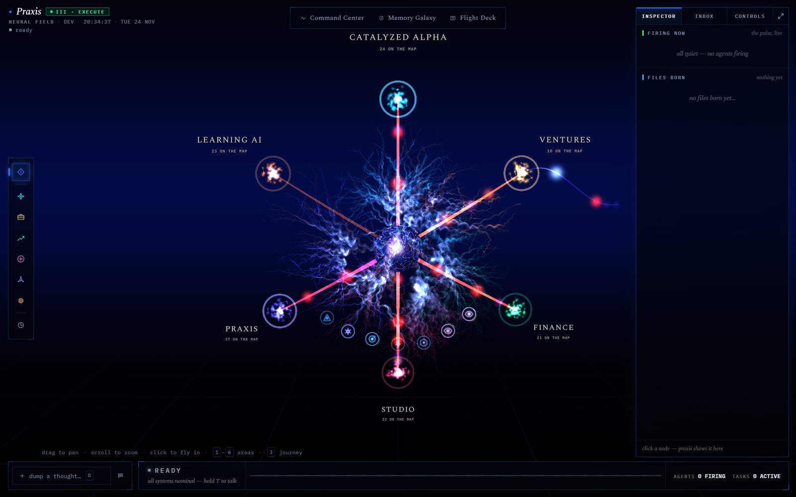
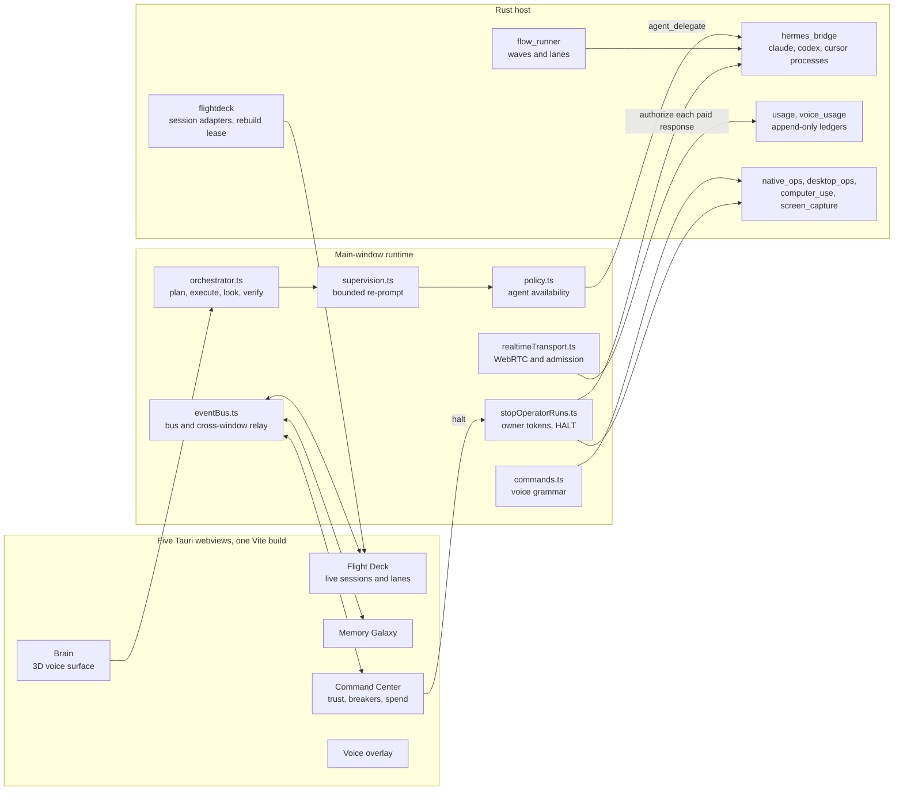
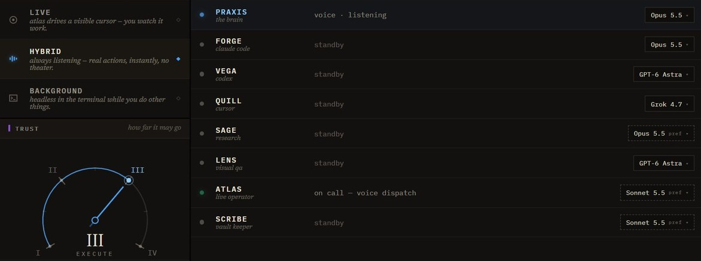
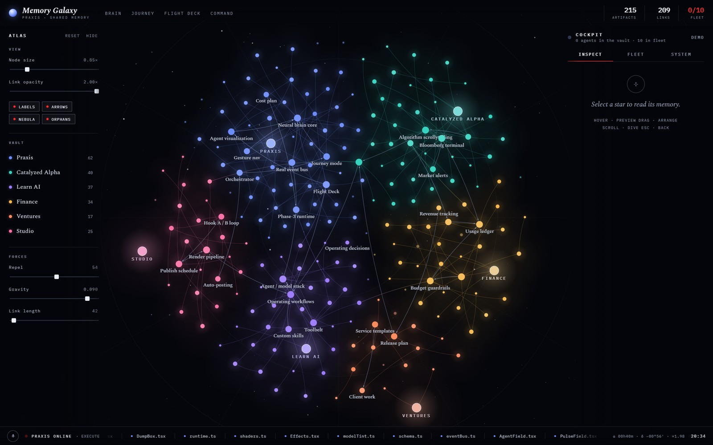

# Praxis

A Windows desktop environment for orchestrating coding agents. Praxis reads the live state of Claude Code, Codex and Cursor sessions and runs flows of headless agents in parallel lanes, one process per lane. It verifies each lane when it exits and is driven by voice. The interface is React and Three.js in five webviews hosted by Tauri, a Rust desktop framework; the difficult parts are in the Rust host.



| Measured in this repository | |
|---|---|
| Rust host | 48,429 lines in 54 source files |
| TypeScript and TSX | 67,645 lines |
| Rust unit tests | 418 pass, 14 ignored because they need live services |
| Node test suites | 38 pass; some assert on source text |
| Application windows | Brain, Flight Deck, Memory Galaxy, Command Center, plus a voice overlay |

Built by Zachary Adams from 06/2026 by directing AI coding agents.

## Architecture



## Rust engineering problems

### Secondary windows that deadlock their creating thread

`WebviewWindowBuilder::build()` blocks until the main thread services it. Called from a synchronous command, which itself runs on the main thread, it never returns and the window stays blank. Every secondary window is therefore built on its own thread, and the caller gets a result without waiting on the event loop. [`lib.rs`, lines 244 to 415](src-tauri/src/lib.rs#L244)

### A hotkey that cannot bring its window forward

Windows refuses `SetForegroundWindow` from a process that does not own the foreground, so a global hotkey shows the window behind the current app. The host attaches its input queue to the foreground thread for the length of the call, which lifts the lock, and detaches afterwards. [`force_foreground`](src-tauri/src/lib.rs#L181)

### Silent webview or crashed webview

A crashed renderer cannot run the script that would reload it, and a throttled one only looks dead. The watchdog tracks a heartbeat for each visible window and for the voice overlay, which gets a longer limit while hidden because Chromium slows a hidden page's timers. The first missed heartbeat gets a reload. If the call errors, or the window is still silent one cycle later, it escalates: a secondary window is destroyed and recreated, and the main window triggers one app restart guarded by a ten-minute marker so that a crash loop stays inspectable. The overlay is only ever reloaded. Pages outside the app's own origin are not policed. [`spawn_renderer_watchdog`](src-tauri/src/lib.rs#L1031)

### PID reuse

A stored PID can point at an unrelated process later. The spawn registry keeps the creation time from `GetProcessTimes` beside the PID and drops the record on a mismatch, so a recycled PID is never shown as a Praxis session when its record carries a creation time. Tests cover a match, a recycled PID, and records written before the field existed. The stop command makes its own check and refuses to kill a PID whose image name is not the expected driver. [`spawned_record_is_live`](src-tauri/src/flightdeck.rs#L5591)

### A rebuild lease that survives a panic

Snapshot rebuilds scan several session stores and may hang on a sleeping disk. A boolean flag leaked when a rebuild panicked or the laptop slept through one. The lease is generation-fenced and released in `Drop`, so a superseded rebuild cannot clear its successor's flag. One test races 16 threads through a barrier for the claim. [`RebuildLease`](src-tauri/src/flightdeck.rs#L4487)

### Batch shims that drop arguments

npm installs command-line tools on Windows as `.cmd` shims. Passing a multi-line prompt through `cmd.exe /C` truncates it at the first newline and silently drops every flag after it. The host parses the shim, finds the script it runs, and spawns `node` with an argument vector. A test scans the sources so that no module outside a four-file allowlist builds `Command::new("cmd")`. A shim that cannot be parsed still goes through `cmd /C`, and the host logs it. [`npm_shim_target`](src-tauri/src/hermes_bridge.rs#L199)

### Ledgers that survive a crash mid-write

Usage is written to an append-only JSONL journal with `sync_data`, then folded into an accumulator replaced atomically with `MoveFileExW`. On the next ledger access, entries past the accumulator's sequence are replayed, gaps fail closed, and a partial tail line is fenced off. Voice usage compacts up to a watermark, the end of the contiguous compacted prefix. Using the highest id seen would be wrong, because a live entry with a lower id is a gap that must hold the watermark back. [`usage.rs`, line 859](src-tauri/src/usage.rs#L859), [`voice_usage.rs`, line 1027](src-tauri/src/voice_usage.rs#L1027)

### Paid audio with no trusted client

The webview never holds the account key. The host mints an ephemeral token, writes a durable reservation with `create_new` and `sync_all` before the request, and releases it in a drop guard if the mint fails. The session is configured so nothing is billed implicitly; every paid response waits for the host to authorize it. [`openai_realtime.rs`](src-tauri/src/openai_realtime.rs), [`realtimeTransport.ts`](src/voice/realtimeTransport.ts)

## Orchestration

A flow is an ordered list of waves. A wave is a set of lanes that run in parallel. A lane is one headless agent process with a working directory, prompt, model, timeout and verify command. [`flow_runner.rs`](src-tauri/src/flow_runner.rs) watches each lane to exit, runs its verify command, retries once with the failure tail appended to the prompt, then marks the lane escalated and records the failure for review while the rest of the flow runs. State is written after every transition, and a flow interrupted by a restart continues at its interrupted wave. The trust dial ([`autonomyPolicy.ts`](src/shared/autonomyPolicy.ts)) decides whether a flow may start: Observe refuses, Propose asks before every step, Execute and Sovereign run. Nothing spawns while the halt breaker is set.

[`orchestrator.ts`](src/orchestrator/orchestrator.ts) is the reasoning loop above that. Planner, worker and verifier are language models, so code can overrule a passing verdict. A website build must pass a file check (entry page present, titled, free of placeholder text), and visible problems found in the screenshots force one fix pass. Once the file check passes, a verdict that only asks to open the finished result counts as done, because delivery is a separate step. Exit codes are recorded and not trusted: a step that timed out may already have written its files, so the files decide.

| Module | Property |
|---|---|
| [`supervision.ts`](src/orchestrator/supervision.ts) | Two re-prompts at most; every read and write is injected, so the loop is tested without a model; a disk check outranks the model evaluator |
| [`policy.ts`](src/orchestrator/policy.ts), [`drivers.ts`](src/orchestrator/drivers.ts) | Resolves which agent CLI is usable in a fixed order: breaker, failure memory, Cursor install and Codex login probes, usage window |
| [`ownedRuns.ts`](src/orchestrator/ownedRuns.ts), [`stopOperatorRuns.ts`](src/voice/stopOperatorRuns.ts) | Stop waits for a terminal acknowledgement from the run that owns the token |
| [`commands.ts`](src/voice/commands.ts) | Voice grammar refuses ambiguous window-control phrases before anything can mutate |
| [`autonomyPolicy.ts`](src/shared/autonomyPolicy.ts) | Trust dial as a pure decision table, mirrored in [`autonomy.rs`](src-tauri/src/autonomy.rs) |
| [`src/markdown`](src/markdown) | Sanitizes model output before rendering it in a webview that can call native code |



## Rendering

The brain view keeps its graph state and animation outside React. [`runtime.ts`](src/brain/runtime.ts) owns preallocated typed arrays and advances pulses and agent transit at frame rate. [`EdgeField.tsx`](src/brain/EdgeField.tsx) merges every edge into one tube mesh and packs per-edge state into a float texture, so hundreds of edges cost one draw call.



## Local setup

```bash
npm ci
npm run build                          # type-check and bundle
for f in scripts/test-*.cjs; do node "$f" || break; done   # one suite drives Edge or Chrome
(cd src-tauri && cargo test --lib)     # Windows, Rust stable
npm run dev                            # http://127.0.0.1:1430 in a browser, sample data
```

`npm run tauri dev` starts the desktop app. In a plain browser the windows run on sample data, which is how the screenshots here were taken.

## Repository map

| Path | Contents |
|---|---|
| `src-tauri/src` | Rust host: processes, windows, ledgers, desktop control, session adapters |
| `src/orchestrator` | Mission planning, supervision, agent availability, unattended runs |
| `src/voice` | Grammar, routing, realtime transport, stop handling |
| `src/brain`, `src/knowledge` | 3D and canvas rendering |
| `src/flightdeck`, `src/command` | Session deck, trust and spend console |
| `praxis-browser` | Node browser sidecar: a deterministic executor that takes line-delimited JSON commands from the Rust host |
| `scripts` | Contract tests, build tools and Windows install scripts |

## Public copy

Four host modules read usage meters through other vendors' sign-ins or unpublished endpoints. Their vendor-specific halves are replaced with stubs that keep the same types, so every caller compiles unchanged: [`claude_usage.rs`](src-tauri/src/claude_usage.rs), [`codex_usage.rs`](src-tauri/src/codex_usage.rs), [`cursor_usage.rs`](src-tauri/src/cursor_usage.rs) and [`openai_billing.rs`](src-tauri/src/openai_billing.rs). [`PROVENANCE.md`](PROVENANCE.md) lists the source revision and every class of change.

## Working method

Praxis was built with the kind of agents it runs. Each reported failure became a rule in code with a test beside it: the source-scan test against `cmd.exe`, the recycled-PID test, the panicking-rebuild test. Comments record why an alternative was rejected, so that a later agent does not repeat it.
